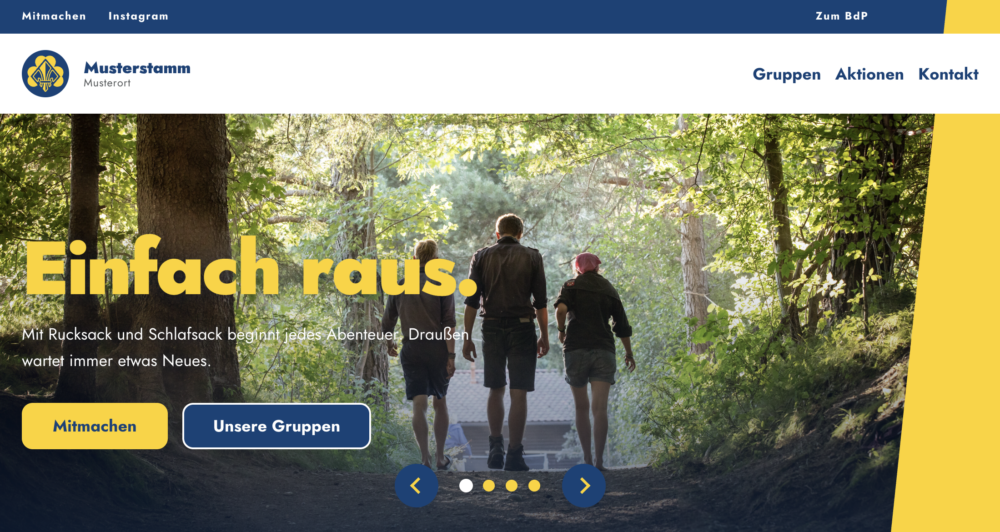

# BdP Stammeswebsite Template

Fertige Website für BdP-Ortsgruppen. 
Klonen, Datenbank einspielen, Stammesname eintragen, fertig :)
> Hinweis: Es handelt sich hierbei nicht um das Offizille BdP Template. Lediglich wurde es am [Einfach Umsetzen](https://meinbdp.de/spaces/BUND/pages/432144490/Einfach+umsetzen.+Das+BdP+Corporate+Design) Design inspiriert. Es wurde ursprünglich für den [Stamm der Vaganten](https://stammdervaganten.de/) entwickelt und ist frei verfügbar für alle, die es nutzen wollen. 




Basiert auf [Concrete CMS](https://www.concretecms.org/) mit einem eigens entwickelten Theme und Paket (`einfach_bdp`) für die typischen Bedürfnisse eines BdP-Stammes: Kalender, Gruppenübersicht, Aufnahmeantrag, Kämmerei-Abrechnung und eine Verwaltungsoberfläche, die keine HTML-Kenntnisse voraussetzt.

---

## Deployment

### Was du brauchst

- Webhosting mit PHP 8.1+ und MySQL 5.7+ (jeder normale Shared-Hoster reicht)
- FTP/SFTP-Zugang
- phpMyAdmin oder ähnliches zum Datenbankimport

### Einrichten in 4 Schritten

**1. Repo klonen**

```bash
git clone https://github.com/maximilian-beuss/bdp-stammeswebsite-template.git
```

**2. Dateien hochladen**

Alle Dateien per FTP in den Webroot (`public_html/` o.ä.). Nicht hochladen: `docker/`, `backups/`, `.git/`

**3. Datenbank anlegen und importieren**

Im Hostingpanel eine MySQL-Datenbank anlegen, dann `backups/demo.sql.gz` über phpMyAdmin importieren.

**4. Datenbankverbindung eintragen**

`application/config/database.php` anpassen:

```php
'server'   => 'localhost',
'database' => 'dein_datenbankname',
'username' => 'dein_datenbanknutzer',
'password' => 'dein_passwort',
```

**5. Einloggen**

`/index.php/login` — Benutzername `admin`, Passwort `admin`

---

## Erste Schritte nach dem Login

| Was | Wo |
|---|---|
| **Passwort ändern** ← zuerst! | Dashboard → Mein Profil |
| Stammesname, Ort, Logo | Dashboard → einfachBdP → Stamm |
| Topbar-Links (Mitmachen, Instagram …) | Dashboard → einfachBdP → Stamm |
| Termine eintragen | Dashboard → einfachBdP → Termine |
| Seiteninhalte bearbeiten | Im Frontend auf „Bearbeiten" klicken |
| Impressum & Datenschutz befüllen | Seiten `/impressum` und `/datenschutz` im CMS |
| Site-Name und SEO | Dashboard → System → SEO & Statistics |

---

## Lokale Entwicklung

```bash
docker compose up -d
```

Läuft dann auf `http://localhost:8080`. Datenbank-Credentials: `vaganten / vaganten / vaganten`.
